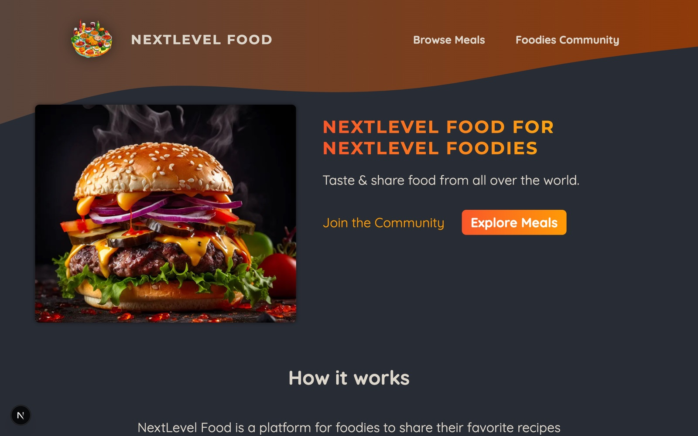

<div align="center">

# 🍲 Foodies — Recipe Community

A Next.js community app where food lovers browse meals and share their own recipes with images.

<a href="https://github.com/miladmo68/Foodies"></a>
<a href="https://miladweb.com"></a>

</div>

<p align="center">
  
</p>

## ✨ Features

- Browse meals and open detailed recipe pages
- Share a meal with an image picker and form
- SQLite storage with images on Amazon S3
- Server components and server actions

## 🛠️ Tech Stack

    

> [!NOTE]
> This project needs its own backend, database or API keys, so it runs locally rather than as a static demo.

## 🚀 Getting Started

**Prerequisites:** [Node.js](https://nodejs.org/) 18 or newer

**Install and run**

```bash
git clone https://github.com/miladmo68/Foodies.git
cd Foodies
npm install
npm run dev
```

### Environment variables

Create a `.env` file (or `.env.local` for Next.js) with:

```env
AWS_ACCESS_KEY_ID=
AWS_SECRET_ACCESS_KEY=
```

## 📁 Project Structure

```
Foodies/
├── app/
├── assets/
├── components/
├── lib/
├── public/
├── initdb.js
├── jsconfig.json
├── meals.db
├── next.config.js
└── package.json
```

## 👤 Author

**Milad Mohammadi** — Frontend-Focused Full-Stack Developer, Toronto 🇨🇦

[](https://miladweb.com)
[](https://www.linkedin.com/in/miladmo68/)
[](https://github.com/miladmo68)

<p align="center"><sub>If you like this project, consider giving it a ⭐</sub></p>
